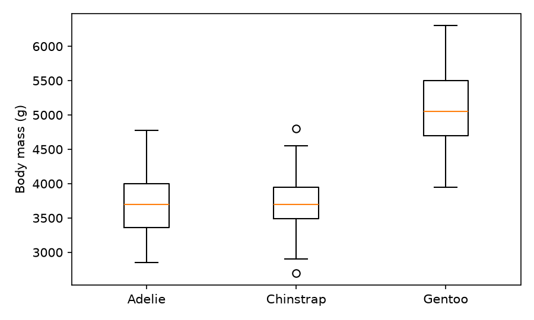

## Summary

This report compares the body mass of three kinds of penguin. The Gentoo penguins were the heaviest, at 5,092 g on average.

## Data

The measurements are for 333 penguins on three islands. Rows with missing values were removed before the analysis.

## Results

| Species | Penguins | Mean body mass (g) | Mean flipper length (mm) |
|---|---|---|---|
| Adelie | 146 | 3,706 | 190 |
| Chinstrap | 68 | 3,733 | 196 |
| Gentoo | 119 | 5,092 | 217 |

## Conclusion

Gentoo penguins are clearly heavier than the other two kinds.
